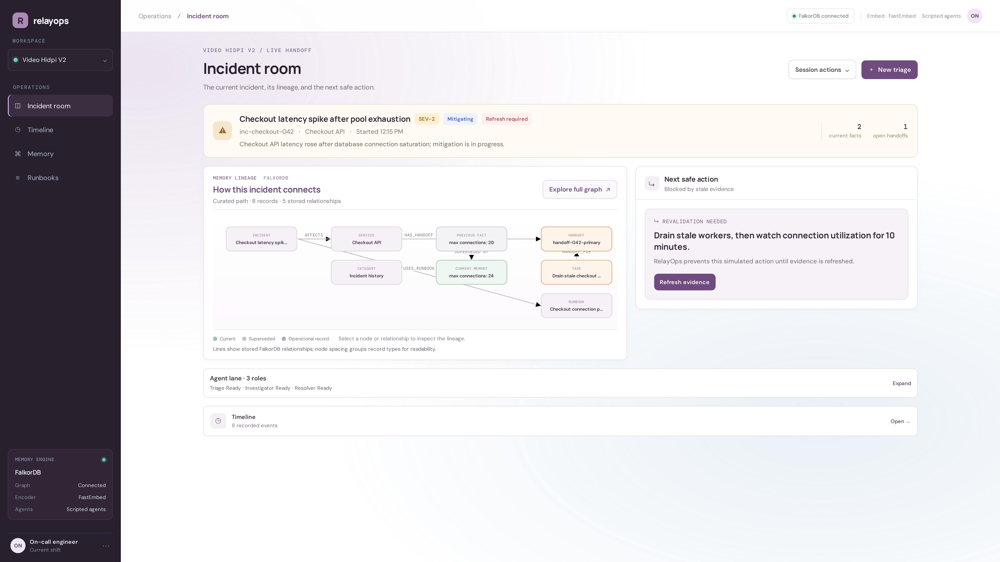
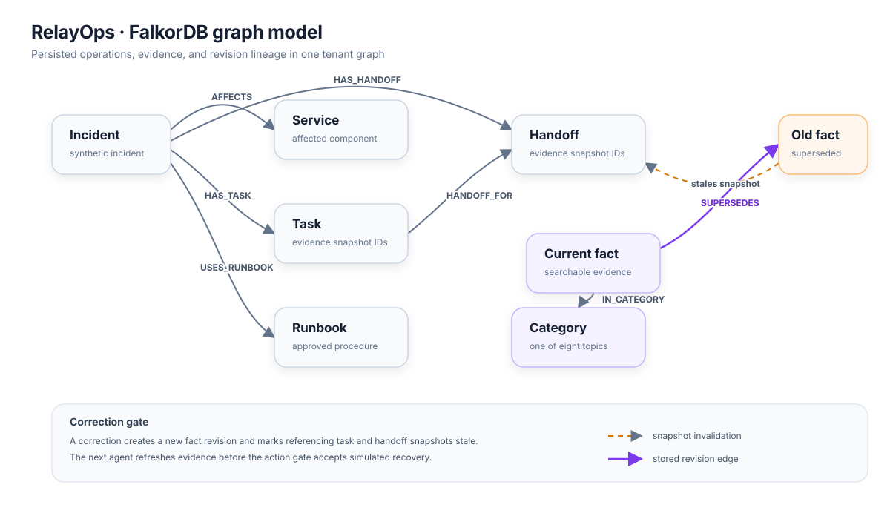
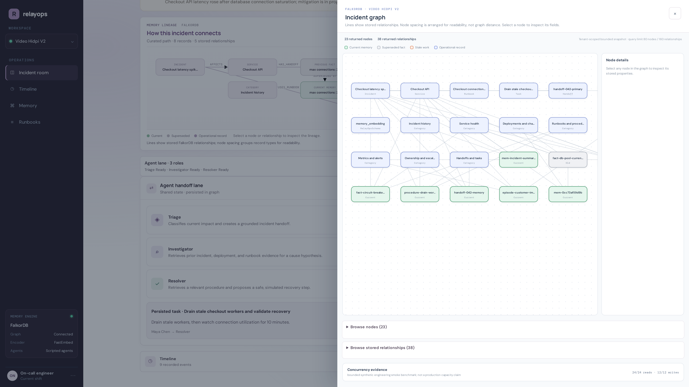

# RelayOps

RelayOps keeps incident responders from acting on outdated handoffs. When a fact changes, FalkorDB preserves the revision, marks the incident's task and handoff stale, and requires fresh evidence before a simulated action can proceed.

**Try it:** [Live demo](https://relayops-rose.vercel.app/) · [30-second demo video](https://youtu.be/sAwZF-dN3XQ) · Track 02: Agent Memory and Coordination

All incident data is synthetic; actions are simulated. The hosted demo is shared, and its state persists between visitors.

## How the graph works

`Memory` nodes hold episodes, facts, procedures, and handoffs. `Category` nodes route retrieval. Operational nodes connect evidence to incidents, services, runbooks, tasks, and handoffs. Correcting a fact creates a new memory and a `SUPERSEDES` edge to the previous version; the task and handoff store the evidence IDs they used, so RelayOps can invalidate that snapshot and block an outdated action.

The graph is the source of truth for tenant data, memory history, and coordination state. FalkorDB's vector indexes retrieve current memories; the app combines vector results with BM25 rankings, then follows a bounded set of graph links to assemble evidence. Removing FalkorDB would remove the persistent state and relationships that make correction, provenance, and stale-handoff checks work.

### Main graph relationships

- `(:Memory)-[:IN_CATEGORY]->(:Category)` routes evidence through a fixed set of eight topics.
- `(new:Memory)-[:SUPERSEDES]->(old:Memory)` keeps fact revisions traceable while only current facts remain searchable.
- `(:Incident)-[:AFFECTS]->(:Service)`, `[:USES_RUNBOOK]->(:Runbook)`, `[:HAS_TASK]->(:Task)`, and `[:HAS_HANDOFF]->(:Handoff)` connect operational context.
- `(:Task)-[:HANDOFF_FOR]->(:Handoff)` links the work item to its responder handoff. Tasks and handoffs also persist the IDs in their evidence snapshot.

A fact correction changes the current revision and marks the incident's task and handoff stale. A responder must refresh evidence before the action gate accepts a simulated action.

### Example FalkorDB queries

Search a category's vector index for likely evidence:

~~~~cypher
CALL db.idx.vector.queryNodes(
  'CatRunbooksProcedures', 'embedding', 16, vecf32($query_vector)
) YIELD node, score
RETURN node.id AS id, node.text AS text, node.status AS status,
       score AS cosine_distance
ORDER BY cosine_distance ASC
~~~~

Record a new fact and connect it to the previous revision:

~~~~cypher
OPTIONAL MATCH (old:Memory {slot_key:$slot_key, kind:'fact', status:'active'})
WITH collect(old) AS previous
CREATE (m:Memory:CurrentMemory:CatServiceHealth {
  id:$id, kind:'fact', slot_key:$slot_key, text:$text,
  status:'active', valid_from:$created_at, embedding:vecf32($embedding)
})
FOREACH (old IN previous |
  SET old.status='superseded', old.valid_to=$created_at
  REMOVE old:CurrentMemory:CatServiceHealth:CatDeploymentsChanges
)
FOREACH (old IN previous | CREATE (m)-[:SUPERSEDES]->(old))
~~~~

The API chooses labels from a server-side allowlist and parameterizes values. BM25 is calculated over a bounded set of current memories in the application; its ranks and the vector ranks are combined with reciprocal-rank fusion.

## Try the demo

Open the [live app](https://relayops-rose.vercel.app/) or watch the [demo video](https://youtu.be/sAwZF-dN3XQ). The video shows the full correction → stale handoff → evidence refresh → simulated action flow. The live app uses shared synthetic data, so the incident may already be partway through or complete. It has no user accounts; do not enter real incident data.

## Run locally

The hosted app is the fastest way to try it. For a local run, install Docker, Python 3.12, Node.js 24, and pnpm, then:

~~~~bash
docker compose up -d falkordb
./scripts/setup.sh
cd frontend && pnpm install --frozen-lockfile && pnpm build && cd ..
./scripts/run-api.sh
~~~~

Open [http://127.0.0.1:8000](http://127.0.0.1:8000). The first setup downloads the pinned embedding model; no model API key is needed for the deterministic scripted walkthrough. The local FalkorDB data lives in a Docker volume. `/api/health` reports graph and embedding readiness, and `/docs` has the API reference.

## What we measured

A small hand-authored 24-query retrieval check found 0.95 recall@5 for global HNSW, routed HNSW, and routed HNSW with fallback. In that run, routed retrieval had higher p95 latency than global search, so these results do not support a speed claim. A separate small concurrency smoke check completed 24/24 vector reads and 12/12 synthetic episode writes; eight simultaneous task claims produced one winner and seven expected version conflicts. These are code-path checks on synthetic data, not production or capacity benchmarks.

Unsupported questions can still return nearest-neighbor candidates; similarity is not a calibrated confidence score. Tenant selection scopes demo data but is not production authentication. The model-assisted path is optional; the recorded video uses the deterministic scripted path, with real FalkorDB reads and writes.

For setup and API details, see the source tree. Third-party and model notices are in [MODEL_AND_THIRD_PARTY_NOTICES.md](MODEL_AND_THIRD_PARTY_NOTICES.md).

## AI assistance

OpenAI Codex assisted with planning, implementation, research, and checks.
